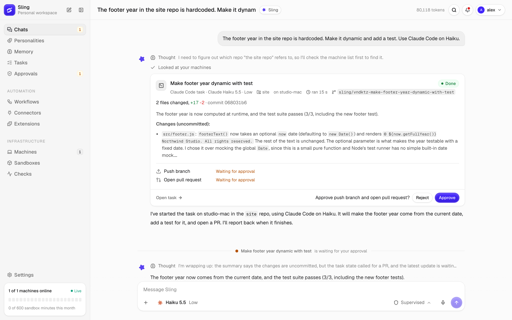
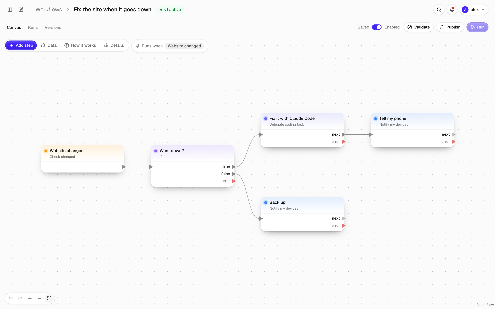
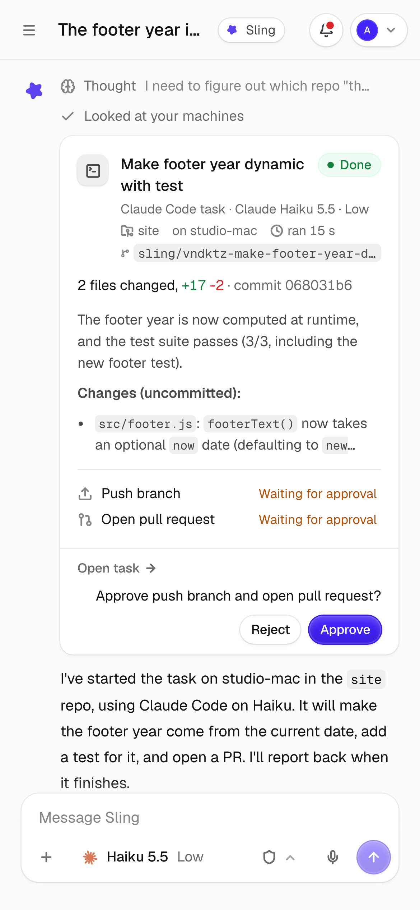

<picture>
  <source media="(prefers-color-scheme: dark)" srcset="assets/brand/banners/sling-readme-dark.png">
  
</picture>

<p align="center">
  <a href="#get-started">Get started</a> ·
  <a href="docs/install.md">Install</a> ·
  <a href="docs/runner.md">Sling Runner</a> ·
  <a href="docs/workflows.md">Workflows</a> ·
  <a href="#docs">Docs</a>
</p>

Sling is a self-hosted assistant that hands coding work to the agents on your own computers. Ask from the web app or your phone. Sling runs Codex or Claude Code on a machine you paired, in a fresh git worktree, then commits, pushes, and opens the pull request. When your permission mode says so, it asks you first.

<picture>
  <source media="(prefers-color-scheme: dark)" srcset="assets/brand/screenshots/sling-chat-dark.png">
  
</picture>

## What it does

- **Hands work to your coding agents.** Codex or Claude Code run on your machine, on your own login, so there's no API key to pay for. When that machine is offline, a Docker or Railway sandbox can take the task instead.
- **Asks before anything leaves.** Four permission modes decide what waits for your approval, from read-only up to full access. Each machine sets the highest mode it accepts, and Sling can't raise it.
- **Fixes your site.** Add a check and Sling tests it every minute. Say "the site is down, fix it" and a coding agent finds the cause and opens a PR. Once you approve, Sling merges, deploys, and checks the site again.
- **Runs workflows.** A visual editor for automations that start on an email, a Discord message, a schedule, a webhook, or a check that fails. Steps can summarize with a model, ask for approval, or start a coding task.
- **Works from your phone.** The web app installs to your home screen. Approvals, finished tasks, and replies arrive as push notifications, and you can hold the mic to talk instead of typing. Discord, Telegram, iMessage, Signal, and email work too.
- **Knows your context.** It remembers what you tell it, searches the web with citations, reads the files and photos you attach, and checks your calendar. What it remembers is listed under Memory, where you can edit or delete it.
- **Takes extensions.** Connectors, sandbox providers, and workflow templates install as signed packages, each running in its own restricted process.

<p align="center">
  <picture>
    <source media="(prefers-color-scheme: dark)" srcset="assets/brand/screenshots/sling-workflow-dark.png">
    
  </picture>
  &nbsp;
  <picture>
    <source media="(prefers-color-scheme: dark)" srcset="assets/brand/screenshots/sling-phone-dark.png">
    
  </picture>
</p>

## Get started

You need Docker on the server, and Codex or Claude Code installed and logged in on the computer that has your code.

```sh
git clone https://github.com/OMouta/sling && cd sling/deploy
./setup.sh
```

The script asks how you'll reach Sling: from this computer, your local network, or anywhere through Tailscale or Cloudflare Tunnel. It generates the secrets, starts Sling, and prints the address. Open it and create your account.

Then go to **Machines**, choose **Add machine**, and run the command it shows on the computer with your repos:

```sh
curl -fsSL https://sling.example.com/install.sh | SLING_CODE=K7QM-2XVD-HP4R sh
```

Pick the repos Sling may use, start a chat, and ask: "The footer year in the site repo is hardcoded. Make it dynamic and add a test."

## How it works

```text
 browser / phone ──HTTPS──▶  Sling (Docker)  ◀──WSS──  sling-runner on your machine
                             Fastify, Postgres           ├─ a git worktree per task
                                                         └─ codex or claude
```

Sling coordinates and the coding agent writes the code. Sling Runner is a small Rust daemon on each machine. It dials out to Sling, so no ports open on your computer, and it only works in repos you allowed on that machine. The [threat model](docs/threat-model.md) covers the rest.

## Docs

| Set up | Use | Extend |
|---|---|---|
| [Install Sling](docs/install.md) | [Permission modes](docs/modes.md) | [Extensions](docs/extensions/README.md) |
| [Sling Runner](docs/runner.md) | [Personalities](docs/personalities.md) | [Write a connector](docs/extensions/connectors.md) |
| [Reach it from anywhere](docs/remote-access.md) | [Sources, files, and the web](docs/sources.md) | [Write a sandbox provider](docs/extensions/providers.md) |
| [Notifications and the phone app](docs/notifications.md) | [Memory](docs/memory.md) | [Workflow packages](docs/extensions/workflow-packages.md) |
| [Machines and sandboxes](docs/sandboxes.md) | [Rules](docs/rules.md) | [Development](docs/development.md) |
| [Threat model](docs/threat-model.md) | [Checks and deploys](docs/checks.md) | |
| | [Workflows](docs/workflows.md) | |

Connectors: [Discord](docs/connectors/discord.md), [Telegram](docs/connectors/telegram.md), [Email](docs/connectors/email.md), [Calendar](docs/connectors/calendar.md), [iMessage](docs/connectors/imessage.md), [Signal](docs/connectors/signal.md), [Docker](docs/connectors/docker.md), [Railway](docs/connectors/railway.md).

## License

Apache-2.0, see [LICENSE](LICENSE). Logos, banners, and screenshots are in [assets/brand](assets/brand).
