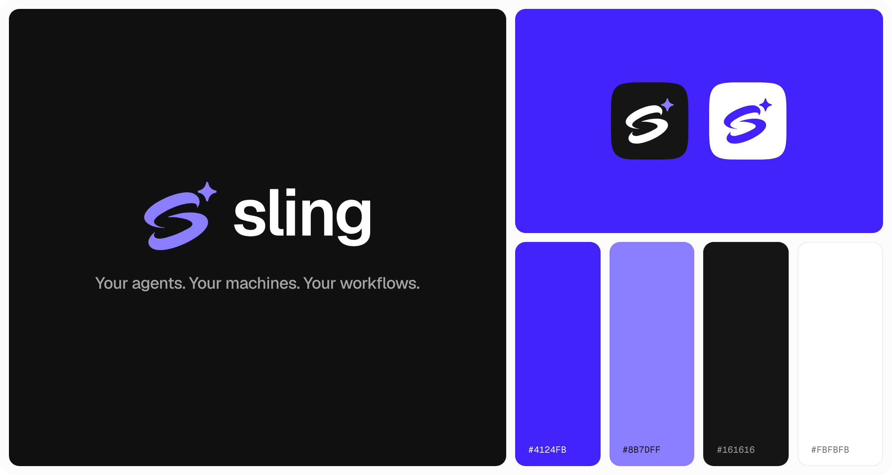
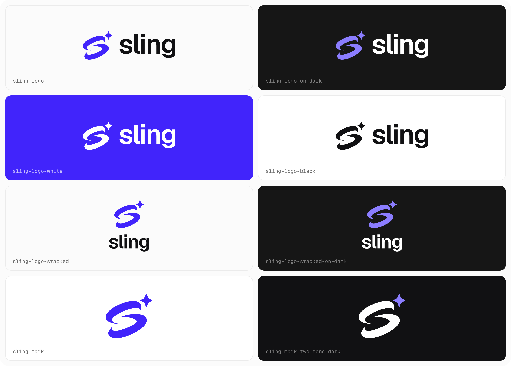
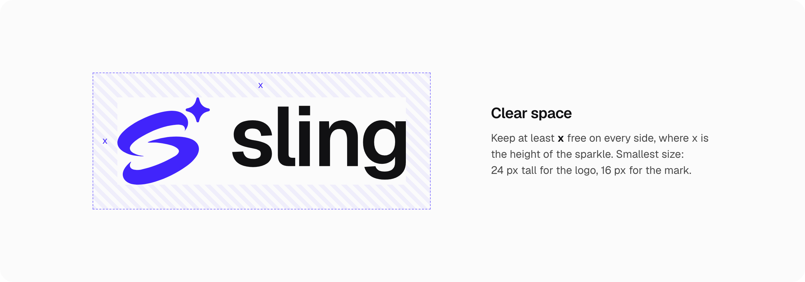
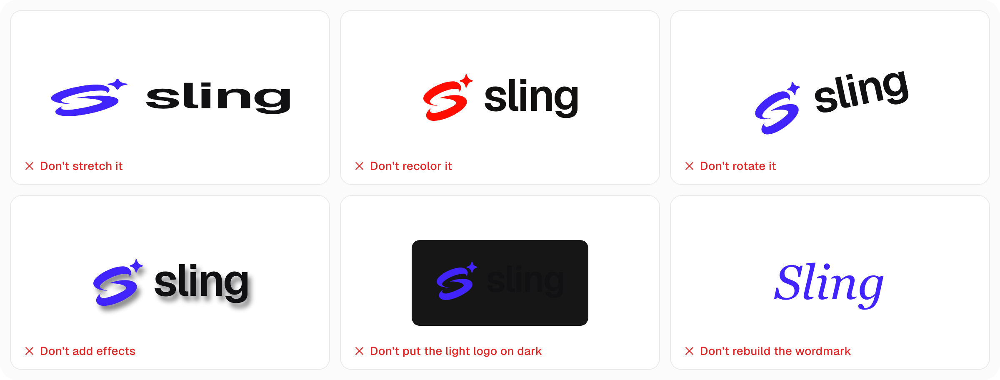
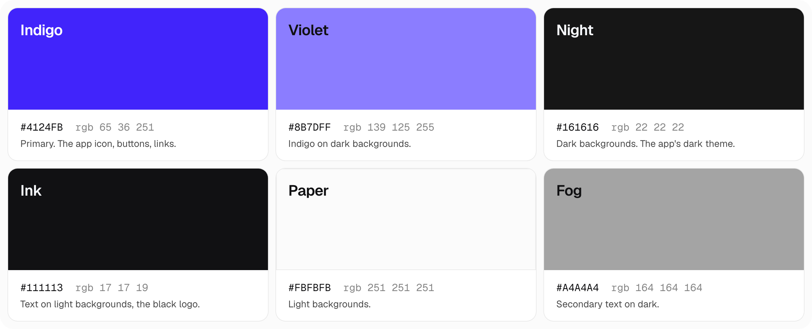
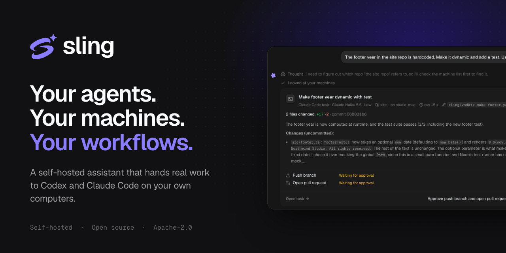

# Sling brand kit

Logos, icons, banners, screenshots, and copy for writing about Sling or linking to it. The SVGs are the source files. Use them wherever a site takes SVG, and the PNGs everywhere else.

## Logo

The logo is the mark, a brushed S with a sparkle, next to the wordmark: "sling" in lowercase. In a sentence, write Sling with a capital S.

| | On light | On dark | One color |
|---|---|---|---|
| Logo | [sling-logo.svg](logo/sling-logo.svg) | [sling-logo-on-dark.svg](logo/sling-logo-on-dark.svg) | [white](logo/sling-logo-white.svg), [black](logo/sling-logo-black.svg) |
| Stacked logo | [sling-logo-stacked.svg](logo/sling-logo-stacked.svg) | [sling-logo-stacked-on-dark.svg](logo/sling-logo-stacked-on-dark.svg) | [white](logo/sling-logo-stacked-white.svg), [black](logo/sling-logo-stacked-black.svg) |
| Mark | [sling-mark.svg](logo/sling-mark.svg) | [sling-mark-violet.svg](logo/sling-mark-violet.svg) | [white](logo/sling-mark-white.svg), [black](logo/sling-mark-black.svg) |
| Two-tone mark | [sling-mark-two-tone.svg](logo/sling-mark-two-tone.svg) | [sling-mark-two-tone-dark.svg](logo/sling-mark-two-tone-dark.svg) | |
| Wordmark | [sling-wordmark.svg](logo/sling-wordmark.svg) | [sling-wordmark-white.svg](logo/sling-wordmark-white.svg) | [indigo](logo/sling-wordmark-indigo.svg) |

Each one has a PNG with a transparent background in [logo/png](logo/png), 2048 px on its long side (1024 px for the marks). On indigo, on a photo, or on any other color, use the white logo.

## App icon

| File | For |
|---|---|
| [sling-app-icon.svg](icon/sling-app-icon.svg) | The icon: the white mark on an indigo tile. PNGs from 16 to 1024 px are in [icon/png](icon/png). |
| [sling-app-icon-dark.svg](icon/sling-app-icon-dark.svg), [sling-app-icon-light.svg](icon/sling-app-icon-light.svg) | Tiles for dark and light themes. |
| [sling-avatar-1024.png](icon/png/sling-avatar-1024.png), [sling-avatar-dark-1024.png](icon/png/sling-avatar-dark-1024.png) | Profile pictures that get cropped to a circle, on GitHub, X, Discord, or Slack. 400 px versions sit next to them. |
| [favicon.ico](icon/favicon.ico), [sling-favicon.svg](icon/sling-favicon.svg) | Browser tabs. The tile is tighter and the mark bigger, so it still reads at 16 px. |
| [sling-app-icon-maskable.svg](icon/sling-app-icon-maskable.svg) | Android's maskable icon, with the mark inside the safe circle. |

## Color

Indigo `#4124FB` is Sling's color. White text on indigo, and indigo text on white, both have a 7.3:1 contrast ratio. Indigo on Night is only 2.5:1, so on dark backgrounds the mark switches to Violet `#8B7DFF` (5.6:1) or to white.

## Type

Everything is set in [Geist](https://vercel.com/font), and code in Geist Mono. Both are free under the SIL Open Font License. Headlines use SemiBold (600) with letter spacing tightened to -0.035em. Body text uses Regular or Medium.

The wordmark is Geist SemiBold converted to outlines, with tighter spacing than the font's default. Use the files, and don't retype it.

## Banners

| File | Size | For |
|---|---|---|
| [sling-social-preview.png](banners/sling-social-preview.png) | 1280 × 640 | GitHub's social preview, under the repo's Settings > General |
| [sling-og.png](banners/sling-og.png), [sling-og-light.png](banners/sling-og-light.png) | 1200 × 630 | Link previews: Open Graph, X cards, Slack, Discord |
| [sling-x-header.png](banners/sling-x-header.png) | 1500 × 500 | X header |
| [sling-linkedin-banner.png](banners/sling-linkedin-banner.png) | 1584 × 396 | LinkedIn cover |
| [sling-square.png](banners/sling-square.png), [sling-square-light.png](banners/sling-square-light.png) | 1080 × 1080 | Posts on Instagram, LinkedIn, Mastodon, or Bluesky |
| [sling-readme-dark.png](banners/sling-readme-dark.png), [sling-readme-light.png](banners/sling-readme-light.png) | 2560 × 600 | A README header, with a transparent rounded edge |

## Screenshots

Captured from a real Sling at 2x. In the chat, Claude Code on Haiku makes a footer's year dynamic in a small demo repo and waits for approval to push. The workflow sends a coding agent to fix a site when its check fails.

| | Dark | Light |
|---|---|---|
| Chat | [sling-chat-dark.png](screenshots/sling-chat-dark.png) | [sling-chat-light.png](screenshots/sling-chat-light.png) |
| Workflow editor | [sling-workflow-dark.png](screenshots/sling-workflow-dark.png) | [sling-workflow-light.png](screenshots/sling-workflow-light.png) |
| Phone | [sling-phone-dark.png](screenshots/sling-phone-dark.png) | [sling-phone-light.png](screenshots/sling-phone-light.png) |

## Words

The product is Sling. The daemon on each machine is Sling Runner, or `sling-runner` as a command.

Tagline: Your agents. Your machines. Your workflows.

One line:

> Sling hands coding work to Codex and Claude Code on your own computers, and opens the pull request.

About 50 words:

> Sling is a self-hosted assistant for people who use coding agents. Ask for a change from the web app, your phone, Discord, or Telegram. Sling runs Codex or Claude Code on a machine you paired, in a fresh git worktree, then commits, pushes, and opens the pull request. It asks first when you want it to.

About 100 words:

> Sling is a self-hosted assistant that hands real work to the coding agents on your own computers. Ask for a change from the web app, your phone, or a chat app, and Sling runs Codex or Claude Code on a machine you paired, on your own subscription. The agent works in a fresh git worktree. Sling commits, pushes, opens the pull request, and asks before each step your permission mode holds back. A workflow engine with a visual editor reacts to email, schedules, webhooks, and failing site checks. A small daemon on each machine dials out to Sling, so no ports open on your computer. Sling is open source under Apache-2.0.

## Using the name and logo

The Apache-2.0 license covers Sling's code, not its name or logo. Use them to refer to Sling, link to it, or write about it. Don't use them in a way that suggests Sling made or endorses something it didn't.
